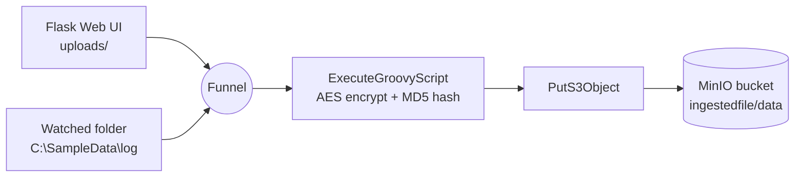

# Secure Data Ingestion Pipeline

A secure, scalable pipeline for ingesting and normalizing security log data. Files are collected through a Flask web UI or a watched folder, encrypted and hashed in **Apache NiFi**, then stored in **MinIO** (S3-compatible cloud storage).

> Final Year Project
> Author: Muhamad Afiq Firdaus Bin Md Zam Zamir

## How It Works




1. **Upload**: drag and drop a file in the web UI, or copy files into the watched folder (for bulk or scalable ingestion).
2. **Encrypt and sign**: NiFi encrypts each file (AES) and generates an MD5 signature.
3. **Store**: the result is uploaded to the MinIO bucket `ingestedfile`.
   

The web UI also includes a **sample demo** (Fernet encryption + MD5 in `ingest.py` / `decrypt.py`) that shows how tampering with `data.txt ` changes the MD5 hash in `hash.txt` for showcasing at university exhibition.

## Tech Stack

| Component | Version |
|---|---|
| Python | 3.13 |
| Flask | latest |
| Apache NiFi | 2.0.0 |
| Java JDK | 21 |
| MinIO | latest (Windows build) |
| OS | Windows 10 |

## Project Structure

```
Data_ingest_fyp2/
├── app.py          # Flask web server
├── ingest.py       # Sample: encrypt data.txt + generate MD5 hash
├── decrypt.py      # Sample: decrypt storage.txt
├── data.txt        # Sample log data
├── templates/      # HTML pages
├── static/         # CSS and images
└── uploads/        # Auto-created; NiFi reads files from here
```

## Setup

### 1. Install Python packages

```powershell
pip install --upgrade pip
pip install bcrypt flask cryptography
```

### 2. Install NiFi

1. Install [JDK 21](https://www.oracle.com/java/technologies/downloads/#jdk21-windows).
2. Download [nifi-2.0.0-bin.zip](https://archive.apache.org/dist/nifi/nifi-2.0.0/nifi-2.0.0-bin.zip) and extract it to `C:\nifi\nifi-2.0.0`.
3. Set environment variables:
   - `JAVA_HOME` = `"C:\Program Files\Java\jdk-21"`
   - `NIFI_HOME` = `C:\nifi\nifi-2.0.0`
4. In `conf\nifi.properties`, set:
   ```
   nifi.web.https.host=localhost
   nifi.web.https.port=8443
   ```
5. Set your login in `conf\login-identity-providers.xml` (`Username` and `Password` properties). The password must be a **bcrypt hash**:
   ```python
   import bcrypt
   print(bcrypt.hashpw(b"your_password", bcrypt.gensalt()).decode())
   ```

### 3. Start NiFi

```powershell
$env:JAVA_HOME = "C:\Program Files\Java\jdk-21"
$env:NIFI_HOME = "C:\nifi\nifi-2.0.0"
cd C:\nifi\nifi-2.0.0\bin
cmd /c "nifi.cmd start"
```

Open <https://localhost:8443/nifi> (may take a few minutes to load) and log in.

### 4. Set up MinIO

1. Download [minio.exe](https://dl.min.io/server/minio/release/windows-amd64/minio.exe) into `C:\minio` and add the folder to your `PATH`.
2. Start the server with your own credentials:
   ```powershell
   $env:MINIO_ROOT_USER = "<your_username>"
   $env:MINIO_ROOT_PASSWORD = "<your_strong_password>"
   cd C:\minio
   .\minio.exe server C:\minio --console-address :9001
   ```
3. Open the console URL printed in the terminal and log in.
4. **Create a bucket** named `ingestedfile`, then create a folder path `data` inside it.
5. **Create an access key** for NiFi (set an expiry date) and attach this policy:
   ```json
   {
     "Version": "2012-10-17",
     "Statement": [
       {
         "Effect": "Allow",
         "Action": ["s3:ListBucket", "s3:PutObject"],
         "Resource": [
           "arn:aws:s3:::ingestedfile",
           "arn:aws:s3:::ingestedfile/*"
         ]
       }
     ]
   }
   ```

### 5. Build the NiFi flow


**a) Add the AWS credentials service**
`Menu → Controller Settings → Management Controller Services → +` → add **AWSCredentialsProviderControllerService**. Enter your MinIO access key ID and secret key, then **Enable** it.

**b) Add the processors**

| Processor | Key settings |
|---|---|
| **GetFile** (1) | Input Directory: `C:\SampleData\log` |
| **GetFile** (2) | Input Directory: `<path-to>\Data_ingest_fyp2\uploads` |
| **Funnel** | Receives `success` from both GetFile processors |
| **ExecuteGroovyScript** | Script Body: see below. Failure: terminate + retry |
| **PutS3Object** | Bucket: `ingestedfile`<br>Object Key: `data/${filename}`<br>Region: Asia Pacific (Singapore)<br>Credentials Service: the one above<br>Canned ACL: Private<br>Endpoint Override URL: `http://127.0.0.1:9000`<br>Relationships: terminate `success` and `failure` |

**c) Connect them:** GetFile ×2 → Funnel → ExecuteGroovyScript (`success`) → PutS3Object. On the last connection, set the prioritizer to **FirstInFirstOutPrioritizer**.

<details>
<summary><b>ExecuteGroovyScript: Script Body</b></summary>

```groovy
import org.apache.commons.codec.digest.DigestUtils
import org.apache.nifi.processor.io.StreamCallback

def flowFile = session.get()
if (!flowFile) return

flowFile = session.write(flowFile, { inputStream, outputStream ->
    def originalData = inputStream.bytes

    // Use your own 16-byte key. Do not commit real keys to GitHub.
    def encryptionKey = '<16-char-secret-key>'.bytes
    def cipher = javax.crypto.Cipher.getInstance('AES')
    def secretKey = new javax.crypto.spec.SecretKeySpec(encryptionKey, 'AES')
    cipher.init(javax.crypto.Cipher.ENCRYPT_MODE, secretKey)

    def encryptedData = cipher.doFinal(originalData)
    outputStream.write("Encrypted Data: ".bytes)
    outputStream.write(encryptedData)
    outputStream.write("\nMD5 Hash: ".bytes)
    outputStream.write(DigestUtils.md5Hex(originalData).bytes)
} as StreamCallback)

session.transfer(flowFile, REL_SUCCESS)
```
</details>

**d) Start the flow:** click the empty canvas, then press the **Play** button (or right-click each processor → Start).

### 6. Run the Flask web UI

Extract the project (e.g. to your Desktop), then either:

- **VS Code:** `Run → Start Debugging → Flask`, or
- **Terminal:**
  ```powershell
  cd Data_ingest_fyp2
  python app.py
  ```

Open <http://127.0.0.1:5000>. The `uploads/` folder is created automatically.

> If you extract the project somewhere else, update the second GetFile processor's Input Directory to match. If the background image does not load, fix the image path in the CSS file.

## Usage

| Page | What it does |
|---|---|
| **Home** (`/`) | Explains the pipeline and runs the sample ingest on `data.txt` |
| **Display Storage** (`/display`) | Shows the encrypted sample (`storage.txt`) |
| **Decrypt Data** (`/decrypt`) | Decrypts and displays the sample |
| **Real-time Ingest** (`/ingestfile`) | Upload a file. NiFi picks it up and sends it to MinIO |

**Try it:**
1. Open **Real-time ingest file**, upload a log file (e.g. `application_log.txt`).
2. Refresh the MinIO console and check `ingestedfile/data/`.
3. For bulk ingestion, copy several files into `C:\SampleData\log`. NiFi queues them without a data burst.
4. To demo integrity checking, edit `data.txt`, click **Ingest Data** again, and compare the new `hash.txt` value.

## Known Limitations

This is an academic prototype. Before any real use, consider:

- Use **AES-GCM** (or Fernet) instead of plain `AES`, which defaults to ECB mode.
- Use **SHA-256** instead of MD5 for integrity checks.
- Load encryption keys and credentials from environment variables or a secrets manager. Never commit them.
- Keep the MinIO bucket **private** and set expiry dates on access keys.
- Disable `debug=True` in `app.py` in production.
- `ingest.py` saves `key.key` next to the encrypted data, which defeats the purpose of encrypting it.

## Troubleshooting

| Problem | Fix |
|---|---|
| NiFi UI is slow to load | Wait a few minutes after starting |
| Java path errors | Wrap `JAVA_HOME` in quotes because of the space in `Program Files` |
| MinIO console port changes | Use the latest URL printed in the terminal, or pin it with `--console-address :9001` |
| Files not appearing in MinIO | Check the access key, endpoint URL (`http://127.0.0.1:9000`) and that all processors are running |

Please ensure that you have registered AWS account otherwise your file may fail to transfer and get stuck at the last processor in NiFi

## Final Output

Note that the content of the file are encrypted.
